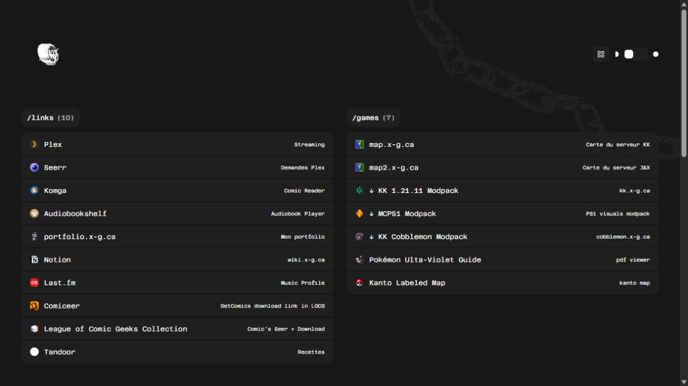

# x-g.ca

> A personal link directory for projects, tools, games, and services.

The site groups links by category and offers an icon-only view and a light or dark theme. It uses Eleventy and Nunjucks to generate the site, with Pages CMS for content editing.

